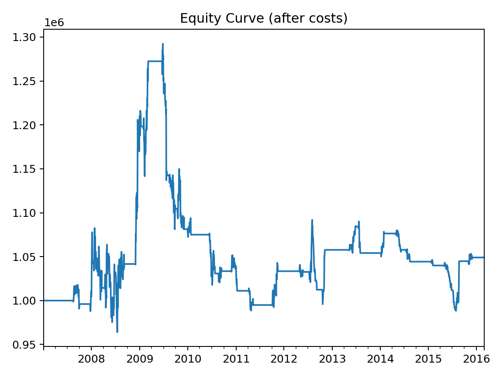

# Pairs Trading Backtesting Framework

A reproducible Python framework for researching and backtesting **statistical arbitrage (pairs trading)** strategies, developed as the final project of the **CQF (Certificate in Quantitative Finance)** program.

The pipeline covers the full quant research workflow: data ingestion and cleaning, cointegration testing, rolling hedge ratio estimation, signal generation, dollar-neutral backtesting with transaction costs and slippage, risk management, and statistical validation.



## Features

- **Cointegration analysis** — Engle–Granger (OLS residual + ADF), Johansen multivariate test, Ornstein–Uhlenbeck half-life estimation
- **Signal generation** — rolling z-score of the spread with stateful entry/exit bands
- **Backtesting engine** — dollar-neutral long/short execution with next-day fills (no look-ahead), per-trade transaction costs and slippage in bps
- **Risk management** — volatility targeting with leverage cap, historical VaR / Expected Shortfall, stress-window analysis (e.g. Covid-19 2020)
- **Statistical validation** — walk-forward evaluation, Sharpe ratio confidence intervals via stationary bootstrap, cost-sensitivity analysis
- **Metrics** — CAGR, annualized return/volatility, Sharpe, Sortino, maximum drawdown, trade-level statistics

## Project structure

```
├── src/pairs_trading/
│   ├── data.py            # CSV loading, alignment, synthetic pair generator
│   ├── cointegration.py   # OLS hedge ratios, ADF / Engle–Granger / Johansen, half-life
│   ├── signals.py         # z-score, band signals, trade extraction
│   ├── backtest.py        # Config + dollar-neutral backtest engine
│   ├── metrics.py         # CAGR, Sharpe, Sortino, drawdown, bootstrap CI
│   └── risk.py            # volatility targeting, VaR/ES, stress windows
├── examples/
│   └── run_backtest.py    # end-to-end demo (synthetic cointegrated pair)
├── notebooks/
│   └── final_project_cqf.ipynb   # full research notebook (CQF final project)
└── requirements.txt
```

## Quick start

```bash
pip install -r requirements.txt
python examples/run_real_data.py   # real 2007–2016 data
python examples/run_backtest.py    # synthetic demo
```

Using your own data (two CSVs with `Date` and `Close` columns):

```python
from pairs_trading import Config, run_pairs_backtest

cfg = Config(
    path_y="data/aapl.csv",
    path_x="data/googl.csv",
    roll_window=60,      # rolling OLS hedge window
    entry_z=2.0,         # enter when |z| > 2
    exit_z=0.5,          # exit when |z| < 0.5
    cost_bps=5.0,        # commission per side, bps
    slippage_bps=2.0,
)
res = run_pairs_backtest(cfg)
print(res["metrics"])    # {'cagr': ..., 'sharpe_ratio': ..., 'max_drawdown_pct': ...}
```

Diagnostic plots (aligned prices, spread, z-score, equity curve) are written to `out/`.

## Results on real data

`examples/run_real_data.py` runs the full pipeline on **real daily adjusted closes (2007–2016)** for MSFT, IBM, SBUX and AAPL (data: [plotly/datasets](https://github.com/plotly/datasets), originally Yahoo Finance):

- Engle–Granger screening on log prices selects **SBUX/AAPL** as the only pair cointegrated at the 5% level (ADF p-value 0.012, OU half-life ≈ 136 days).
- Over the full period, after 7 bps of costs + slippage per side, the naive z-score strategy earns a Sharpe of **≈ 0.06** (95% bootstrap CI [-0.59, 0.61]) — consistent with the well-documented decay of pairs-trading profitability on liquid mega-caps.
- During the **2008–2009 global financial crisis window**, however, the same strategy delivers a **Sharpe of 2.08 with a max drawdown of −7%**, illustrating the crisis-alpha behaviour of mean-reversion strategies when volatility spikes.

No parameter optimization was performed on the reported results: the point of this framework is honest measurement — realistic costs, next-day execution, formal cointegration testing and bootstrap confidence intervals — not curve-fitted performance.

## Methodology

1. **Data** — daily prices aligned on a common business-day calendar; returns winsorized at the 1–99% quantiles during cleaning.
2. **Cointegration** — Engle–Granger residuals tested with ADF; multivariate baskets tested with Johansen (trace statistics vs. 95% critical values); mean-reversion speed summarized by the OU half-life.
3. **Signals** — the spread `y − βx` (rolling OLS β) is standardized into a z-score; positions open beyond ±entry_z and close inside ±exit_z.
4. **Execution** — signals execute at the next day's close (no look-ahead); costs and slippage are charged on every position change.
5. **Validation** — walk-forward train/test splits, stationary-bootstrap confidence intervals for the Sharpe ratio, and cost-multiplier sensitivity analysis guard against overfitting.

## Limitations & next steps

- Execution at daily close; no intraday microstructure or market impact model.
- Cointegration relationships can weaken across regimes — a rolling ADF kill-switch is included in the research notebook.
- Next steps: Kalman-filter hedge ratios, regime detection, and a broader cross-sectional universe.

## Author

**Manoella O. Costa** — CQF (2025) · [LinkedIn](https://linkedin.com/in/manoellacosta)

## License

MIT
